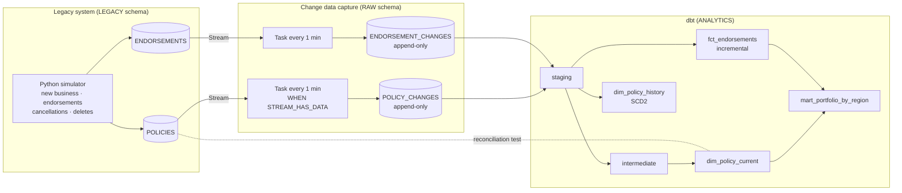

# Insurance CDC on Snowflake: run a legacy system and a modern warehouse side by side


A legacy policy administration system keeps running and overwriting its rows in place.
Every insert, update and delete is captured with **Snowflake Streams**, appended to an
immutable change log by **Snowflake Tasks**, and modeled with **dbt** into a current-state
dimension, a full SCD Type 2 history, an incremental endorsements fact and portfolio KPIs.
A reconciliation test proves the warehouse matches the legacy system.

> Built with public data (French motor insurance portfolio, freMTPL2) to practice the
> pattern I use at work with Qlik Replicate: log-based CDC from a legacy system into
> Snowflake with zero downtime and no big-bang cutover.

## Architecture



## What this project demonstrates

| Concept | Where |
|---|---|
| Log-based CDC capturing I/U/D without touching the source app | [`snowflake/02_streams_tasks.sql`](snowflake/02_streams_tasks.sql) |
| Initial full load + ongoing changes (`SHOW_INITIAL_ROWS`) | same file |
| Immutable change log as the single source of history | `RAW.POLICY_CHANGES` |
| Rebuilding current state from events | [`dim_policy_current`](dbt/models/marts/dim_policy_current.sql) |
| SCD Type 2 history, including hard-deleted records | [`dim_policy_history`](dbt/models/marts/dim_policy_history.sql) |
| Incremental model with `merge` | [`fct_endorsements`](dbt/models/marts/fct_endorsements.sql) |
| Data quality: generic, package and singular tests, source freshness | `_*.yml`, [`dbt/tests`](dbt/tests) |
| Source-to-warehouse reconciliation | [`assert_cdc_reconciles_with_legacy`](dbt/tests/assert_cdc_reconciles_with_legacy.sql) |
| CI/CD: lint, unit tests, dbt build in a throwaway schema per run | [`.github/workflows/ci.yml`](.github/workflows/ci.yml) |
| Security and cost: key-pair auth, RBAC role, auto-suspend, resource monitor | [`snowflake/00_setup.sql`](snowflake/00_setup.sql) |

## Data

- **Source:** [freMTPL2freq](https://www.openml.org/d/41214) on OpenML: 678,013 real French
  motor third-party liability policies (region, vehicle, driver age, bonus-malus, claims).
- **Synthetic on purpose:** premiums (a documented rating formula in
  [`simulator/sql.py`](simulator/sql.py)) and the stream of endorsements, cancellations and
  deletes generated by the simulator. The public dataset has no transaction history, so the
  simulator plays the role of the legacy application.

## Run it

**Prerequisites:** Python 3.11+, a Snowflake account ([free 30-day trial](https://signup.snowflake.com/)).

```bash
# 1. Key pair for the service user (no passwords)
mkdir -p keys
openssl genrsa 2048 | openssl pkcs8 -topk8 -inform PEM -out keys/rsa_key.p8 -nocrypt
openssl rsa -in keys/rsa_key.p8 -pubout -out keys/rsa_key.pub

# 2. In a Snowflake worksheet, run in order (paste the public key into 00_setup.sql):
#    snowflake/00_setup.sql, 01_legacy_tables.sql
#    (02_streams_tasks.sql comes after the seed, step 5)

# 3. Local setup
cp .env.example .env      # fill in your account identifier
make install
make test

# 4. Load the public data and issue the first 50,000 policies
make seed

# 5. Start CDC: run snowflake/02_streams_tasks.sql in Snowflake

# 6. Generate traffic in the legacy system
make simulate

# 7. Build and test the warehouse
make dbt-build
make freshness
```

Pause the tasks when you're done (`snowflake/99_pause_or_teardown.sql`) so the trial
credits last.

### CI secrets

Add `SNOWFLAKE_ACCOUNT`, `SNOWFLAKE_USER` and `SNOWFLAKE_PRIVATE_KEY` (the contents of
`rsa_key.p8`) as repository secrets. Without them CI still runs lint, unit tests and
`dbt parse`; with them it also runs `dbt build` against Snowflake in a schema named
`CI_<run id>` and drops it afterwards.

## Example queries

```sql
-- How the change log looks
select cdc_operation, count(*) from INSURANCE_CDC.RAW.POLICY_CHANGES group by 1;

-- Full history of one policy, including the version before it was cancelled
select * from INSURANCE_CDC.MARTS.DIM_POLICY_HISTORY
where policy_id = 1234 order by valid_from;

-- Portfolio KPIs
select * from INSURANCE_CDC.MARTS.MART_PORTFOLIO_BY_REGION
order by active_written_premium desc;
```

## Design decisions

- **Why an append-only change log instead of merging straight into a target table?**
  The log is the source of truth for history. Current state, SCD2 and any future model can
  be rebuilt from it at any time, and a bug in a model never destroys data.
- **Why Streams + Tasks and not a third-party CDC tool?** It's native to Snowflake, so
  there's nothing to run or license. A tool like Qlik Replicate or Debezium does the same job
  when the source is outside Snowflake (Oracle, SQL Server), by reading the database log.
- **Stream semantics:** a standard stream returns the *net* change since it was last
  consumed. A row inserted and updated within the same minute arrives as one insert. The
  1-minute task schedule keeps that window small; for every intermediate version you would
  use a tool that reads the transaction log.
- **Updates in a stream** arrive as a DELETE + INSERT pair flagged `METADATA$ISUPDATE`. The
  task keeps only the INSERT side and labels it `U`.
- **Hard deletes are captured** and kept in the history (`is_deleted`), which is what
  auditors and regulators expect in insurance.
- **Cost:** `WHEN SYSTEM$STREAM_HAS_DATA` skips task runs when nothing changed, the
  warehouse auto-suspends after 60 s, and a resource monitor caps monthly credits.

## Repository layout

```
snowflake/      setup, legacy tables, streams and tasks, teardown
simulator/      public data seeder + legacy traffic simulator (Python)
tests/          unit tests for the simulator (pytest)
dbt/            staging -> intermediate -> marts, tests, macros
.github/        CI: ruff, pytest, dbt parse, dbt build on Snowflake
```
